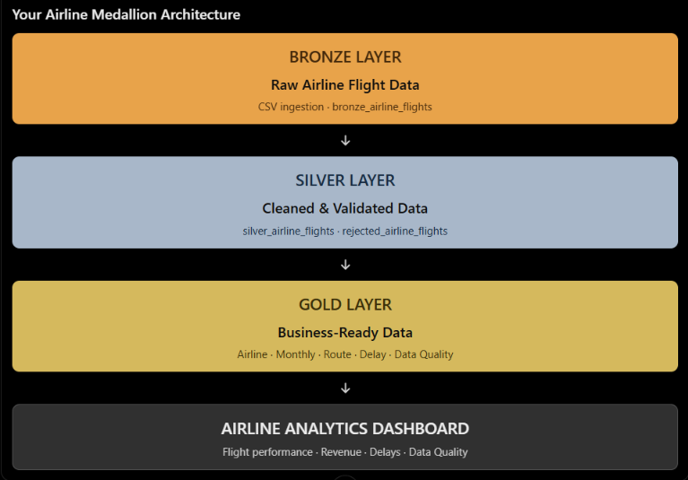
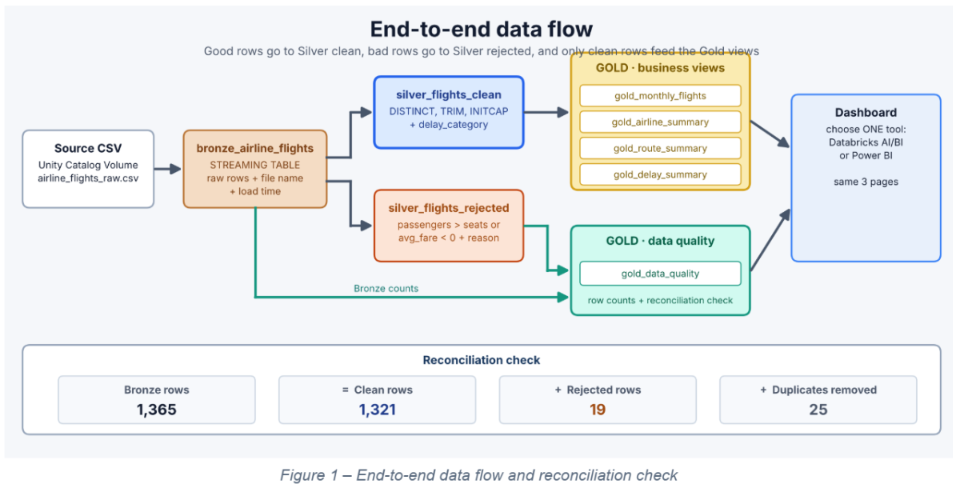
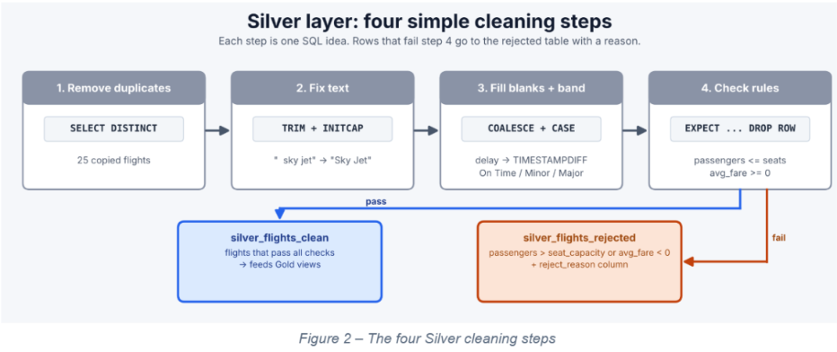
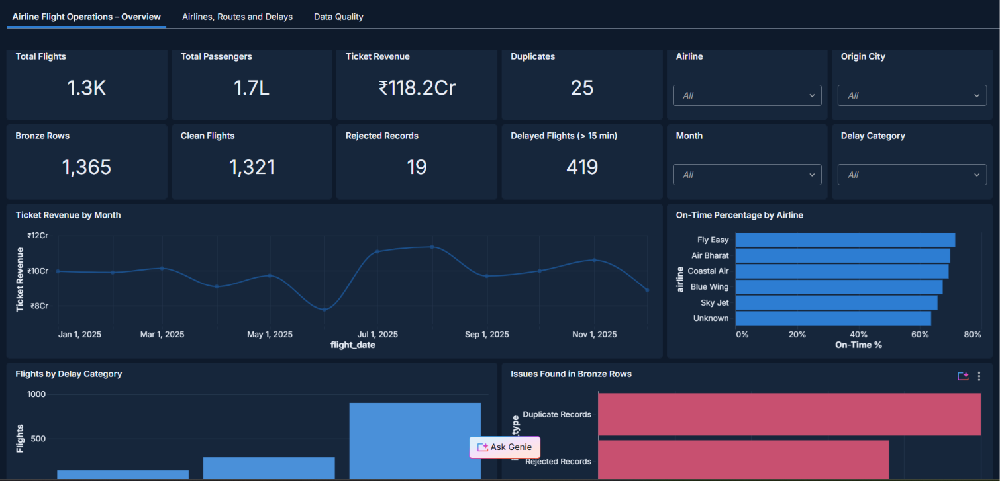
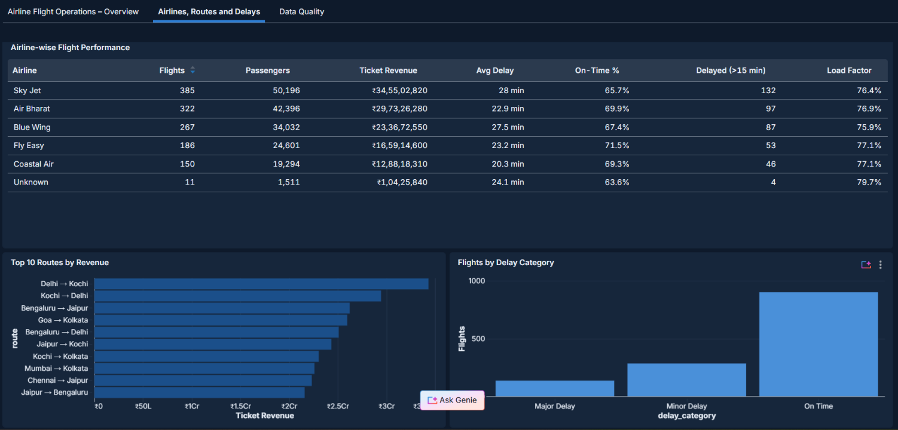
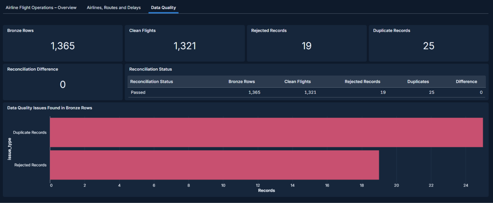

# Airline Flight Operations Analytics Platform: Medallion Architecture with Lakeflow Spark Declarative Pipelines

An end-to-end airline flight operations data engineering project built using **Databricks**, **Lakeflow Spark Declarative Pipelines (SQL)**, and the **Medallion Architecture (Bronze → Silver → Gold)**.

The project transforms raw airline flight data into clean, validated, business-ready analytical tables. It also includes a three-page Databricks AI/BI dashboard to analyze flight performance, airline operations, route performance, delays, revenue, and data quality.



---

## Table of Contents

- [Business Problem](#business-problem)
- [Project Objectives](#project-objectives)
- [Architecture](#architecture)
- [Pipeline Lineage](#pipeline-lineage)
- [Tech Stack](#tech-stack)
- [Dataset](#dataset)
- [Repository Structure](#repository-structure)
- [Layer Details](#layer-details)
- [Data Quality Rules](#data-quality-rules)
- [Reconciliation](#reconciliation)
- [Dashboard](#dashboard)
- [Key Results and Insights](#key-results-and-insights)
- [How to Run](#how-to-run)
- [Key Learnings](#key-learnings)
- [Future Improvements](#future-improvements)
- [Documentation](#documentation)

---

## Business Problem

Airline flight-operation data may contain inconsistent text formats, missing values, duplicate flight records, invalid passenger counts, and negative fare values.

Analyzing raw data without proper cleaning and validation can result in inaccurate reports and business decisions.

**Goal:** Build a repeatable data engineering pipeline that preserves raw data, cleans and validates flight records, separates rejected records, and publishes trusted Gold tables for business analysis.

## Project Objectives

- Ingest raw airline flight data into the Bronze layer.
- Clean and standardize records in the Silver layer.
- Identify duplicate flight records.
- Separate invalid records with rejection reasons.
- Create Gold summary tables for business analysis.
- Perform data-quality checks and reconciliation.
- Build an interactive dashboard to visualize airline operations.

## Architecture

`airline_flights_raw.csv` (Unity Catalog Volume) → **Bronze** (Raw Data) → **Silver** (Cleaned and Validated Data) → **Gold** (Business Aggregates) → **Databricks AI/BI Dashboard**

| Layer | Purpose | Key Actions |
|---|---|---|
| Bronze | Preserve raw source data | CSV ingestion and metadata tracking |
| Silver | Improve data quality | Data cleaning, standardization, deduplication and validation |
| Gold | Business reporting | Airline, monthly, route, delay and data-quality summaries |

### Medallion Architecture


### End-to-End Data Flow



## Pipeline Lineage

The project contains the following tables:

| Object | Layer | Description |
|---|---|---|
| `bronze_airline_flights` | Bronze | Raw airline flight records |
| `silver_airline_flights` | Silver | Cleaned and validated flight records |
| `rejected_airline_flights` | Silver | Invalid records with rejection reasons |
| `gold_airline_summary` | Gold | Airline-wise flight and revenue analysis |
| `gold_monthly_flights` | Gold | Monthly flight and revenue trends |
| `gold_route_summary` | Gold | Route-wise flight and revenue analysis |
| `gold_delay_summary` | Gold | Delay-category analysis |
| `gold_data_quality` | Gold | Data-quality metrics and reconciliation |

## Tech Stack

- Azure Databricks / Databricks
- Lakeflow Spark Declarative Pipelines
- SQL
- Unity Catalog
- Unity Catalog Volumes
- Delta Lake
- Databricks SQL
- Databricks AI/BI Dashboards
- Medallion Architecture

## Dataset

**Dataset:** `airline_flights_raw.csv`

- **Total Records:** 1,365 rows
- **Total Columns:** 20
- **Data Coverage:** Synthetic domestic Indian airline flights during 2025.

### Dataset Columns

| Column | Description |
|---|---|
| flight_id | Unique flight identifier |
| flight_number | Flight number |
| airline | Airline name |
| aircraft_id | Aircraft identifier |
| aircraft_type | Type of aircraft |
| flight_date | Flight date |
| day_of_week | Day of the week |
| origin_city | Departure city |
| destination_city | Arrival city |
| origin_region | Origin region |
| distance_km | Flight distance |
| scheduled_departure | Scheduled departure time |
| actual_departure | Actual departure time |
| delay_minutes | Flight delay in minutes |
| delay_reason | Reason for delay |
| seat_capacity | Total aircraft seats |
| passengers | Number of passengers |
| avg_fare | Average ticket fare |
| ticket_revenue | Total ticket revenue |
| fuel_cost | Fuel cost |

The dataset contains practice data-quality issues such as missing values, inconsistent capitalization, extra spaces, duplicate flight IDs, passengers exceeding seat capacity, and negative average fares.

**Dataset Download:** [Download Airline Flights CSV](https://drive.google.com/file/d/1_fMugUOBCKP1Exq0fZ8fA3UACtym4Qan/view?usp=sharing)

## Repository Structure

```text
Airline-Flight-Operations-Analytics/
│
├── README.md
│
├── data/
│   └── airline_flights_raw.csv
│
├── ETL_Pipeline/
│   ├── Airline_Bronze_Layer.sql
│   ├── Airline_Silver_Layer.sql
│   └── Airline_Gold_Layer.sql
│
├── docs/
│   └── project_documentation.pdf
│
└── images/
    ├── medallion_architecture.png
    ├── end_to_end_data_flow.png
    ├── silver_cleaning_steps.png
    ├── dashboard_layer_design.png
    ├── dashboard_overview.png
    ├── airlines_routes_delays.png
    └── data_quality.png
```

## Layer Details

### 1. Bronze Layer – Raw Data Ingestion

- Reads the raw CSV file from a Unity Catalog Volume.
- Loads the records into `bronze_airline_flights`.
- Preserves original source values.
- Maintains source information and ingestion metadata where configured.

**Source file:** `airline_flights_raw.csv`

**Target table:** `bronze_airline_flights`

### 2. Silver Layer – Data Cleaning

The Silver layer improves data quality and prepares reliable records for analysis.

**Clean table:** `silver_airline_flights`

**Rejected table:** `rejected_airline_flights`

Cleaning activities:

- Remove duplicate records using `flight_id`.
- Trim unnecessary spaces.
- Standardize text capitalization.
- Handle missing airline and delay-reason values.
- Calculate missing delay minutes using scheduled and actual departure times when available.
- Calculate missing ticket revenue using passengers multiplied by average fare when available.
- Validate passenger counts and average fares.
- Create delay categories.

### Delay Categories

| Delay Minutes | Category |
|---|---|
| 15 minutes or less | On Time |
| 16–60 minutes | Minor Delay |
| More than 60 minutes | Major Delay |



### 3. Gold Layer – Business Analysis

The Gold layer contains business-ready summary tables.

| Gold Table | Business Purpose |
|---|---|
| `gold_airline_summary` | Airline-wise flights, passengers, revenue, average delay and load factor |
| `gold_monthly_flights` | Monthly flight and revenue trends |
| `gold_route_summary` | Route-wise flight and revenue analysis |
| `gold_delay_summary` | Flights grouped by delay category |
| `gold_data_quality` | Bronze, clean, rejected and duplicate record counts |

### Key Business Metrics

- Total Flights
- Total Passengers
- Total Ticket Revenue
- Average Delay
- On-Time Percentage
- Load Factor Percentage
- Delayed Flights
- Rejected Records
- Duplicate Records

## Data Quality Rules

| Rule | Treatment |
|---|---|
| Text standardization | Remove unnecessary spaces and standardize capitalization |
| Missing airline | Replace with `Unknown` where applicable |
| Missing delay reason | Replace with `Unknown` where applicable |
| Missing delay minutes | Calculate from departure timestamps when available |
| Missing ticket revenue | Calculate using passengers × average fare when possible |
| Duplicate flight IDs | Retain one record in the clean output |
| Passengers exceeding seat capacity | Reject the record |
| Negative passenger count | Reject the record |
| Negative average fare | Reject the record |
| Delay classification | Categorize into On Time, Minor Delay and Major Delay |

## Reconciliation

The dashboard displays the following data-quality results:

| Check | Result |
|---|---:|
| Bronze Rows | 1,365 |
| Clean Flights | 1,321 |
| Rejected Records | 19 |
| Duplicate Records | 25 |
| Reconciliation Difference | 0 |
| Reconciliation Status | Passed |

The reconciliation checks whether the Bronze records are accounted for by clean records, rejected records, and duplicate records removed.

## Dashboard

The project includes a three-page Databricks AI/BI dashboard.

### Page 1 – Airline Flight Operations Overview

This page displays:

- Total Flights
- Total Passengers
- Ticket Revenue
- Duplicate Count
- Bronze Rows
- Clean Flights
- Rejected Records
- Delayed Flights
- Monthly Ticket Revenue
- On-Time Percentage by Airline
- Flights by Delay Category
- Data-Quality Issues



### Page 2 – Airlines, Routes and Delays

This page provides:

- Airline-wise flight performance
- Passenger analysis
- Ticket revenue comparison
- Average delay by airline
- On-time percentage
- Load factor
- Top routes by revenue
- Flights by delay category



### Page 3 – Data Quality

This page displays:

- Bronze Records
- Clean Flights
- Rejected Records
- Duplicate Records
- Reconciliation Difference
- Reconciliation Status
- Data-Quality Issues



## Key Results and Insights

Based on the supplied dashboard screenshots:

- The project displays **1,365 Bronze records**.
- **1,321 clean flights** are displayed.
- **19 records** are rejected.
- **25 duplicate records** are removed.
- Reconciliation difference is **0**, with status **Passed**.
- The overview displays **419 delayed flights**.
- Sky Jet has the highest flight count, with **385 flights**.
- Fly Easy has the highest on-time percentage, at **71.5%**.
- Delhi → Kochi is the highest-revenue route shown in the dashboard.

*These values are based on the dashboard screenshots and should be rechecked after future pipeline refreshes.*

## How to Run

1. Download `airline_flights_raw.csv` from the dataset link.
2. Upload the CSV into a Unity Catalog Volume in Databricks.
3. Confirm the catalog, schema, and Volume path.
4. Add the Bronze, Silver and Gold SQL files to a Lakeflow Spark Declarative Pipeline.
5. Configure the pipeline target catalog and schema.
6. Run the pipeline and verify the Bronze, Silver and Gold tables.
7. Run the reconciliation checks.
8. Refresh the Databricks AI/BI dashboard.

**Note:** Update the Volume path and catalog/schema names according to your actual Databricks workspace.

## Key Learnings

- Understanding Medallion Architecture.
- Ingesting raw CSV data using Databricks.
- Writing SQL transformations.
- Cleaning and validating data.
- Handling duplicate and rejected records.
- Creating Gold analytical tables.
- Performing data-quality checks and reconciliation.
- Building dashboards for business analysis.

## Future Improvements

- Automate ingestion of new airline flight files.
- Add pipeline monitoring and data-quality alerts.
- Perform more detailed airline and route comparisons.
- Add additional operational KPIs.
- Improve dashboard filtering and drill-down analysis.

## Documentation

For detailed project information, architecture diagrams, data transformations, dashboard screenshots, and business insights, see:

[Project Documentation PDF](docs/project_documentation.pdf)

---

**Project:** Airline Flight Operations Analytics Platform  
**Architecture:** Medallion Architecture (Bronze → Silver → Gold)  
**Tools:** Databricks, SQL, Lakeflow Spark Declarative Pipelines  
**Dashboard:** Databricks AI/BI Dashboard

